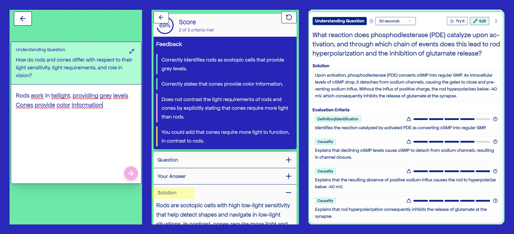
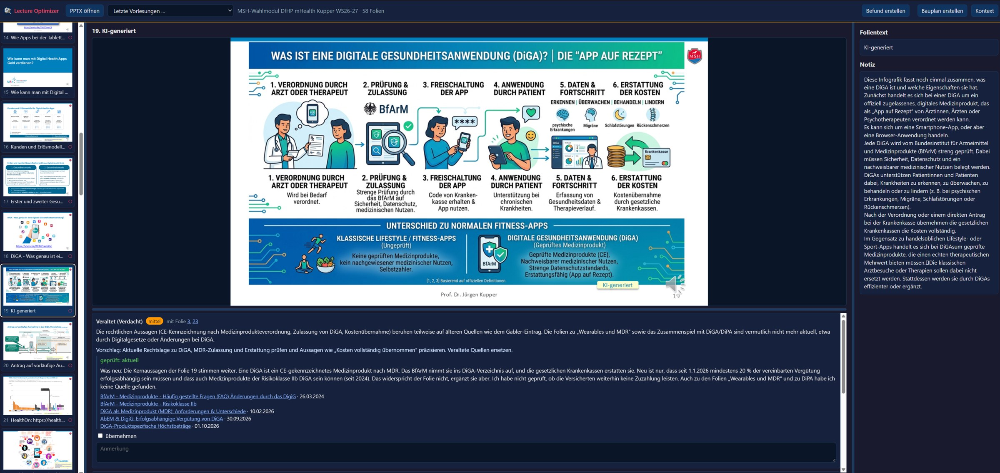
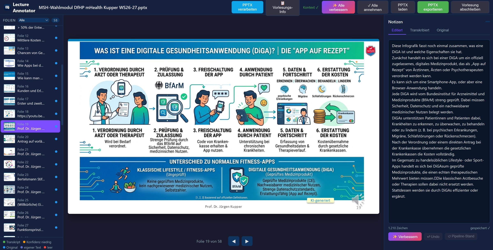
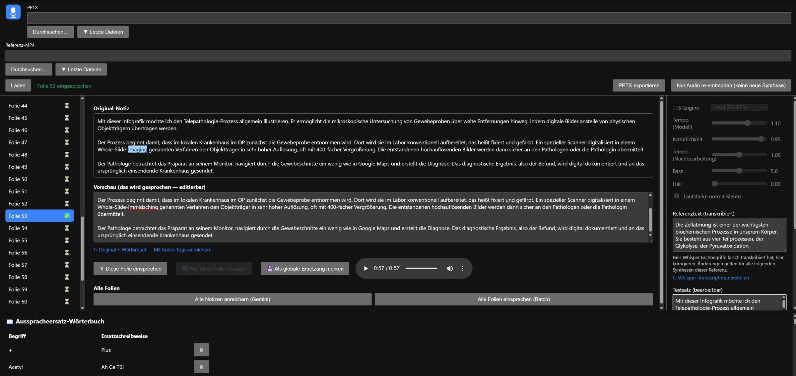
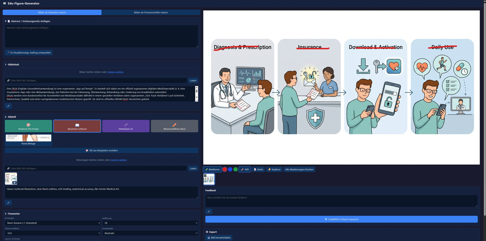

# Dr. Jürgen Kupper

Medizindidaktik & Digital Health · MSH Medical School Hamburg · Hamburg

Ich baue KI-Werkzeuge für meine Lehre selbst – mit Coding-Assistenten, LLM-APIs (Claude, Gemini) und lokalen Modellen; Python/Flask.
Gemeinsames Muster: **Das Modell schlägt vor, der Mensch entscheidet – und jede KI-Ausgabe bleibt prüfbar.**

Die Werkzeuge laufen lokal. Code und Live-Demo zeige ich gern im Gespräch.

---

## KvizMe – kriteriengestützte Bewertung freier Antworten
**Problem:** Multiple Choice prüft Wiedererkennen, nicht Verständnis.
**Lösung:** Lernende antworten frei; ein LLM bewertet die Antwort gegen einzelne, fachlich festgelegte Kriterien und gibt Feedback je Kriterium.
**Bewusste Entscheidung:** Kriterien statt Gesamturteil – jede Bewertung ist nachvollziehbar. Ein Prüfschritt sichert die Quelltreue von Fragen und Lösungen.

## Lecture Optimizer – Folien gegen aktuelle Quellen prüfen
**Problem:** Digital-Health-Inhalte veralten schnell, etwa die DiGA-Rechtslage.
**Lösung:** Ein LLM erstellt je Folie einen Befund mit Schweregrad, Begründung und datierten Belegen.
**Bewusste Entscheidung:** Das Modell sagt ausdrücklich, was es nicht geprüft hat; übernommen wird erst nach Bestätigung.

## Lecture Annotator – Sprechernotizen verbessern
**Problem:** Eingesprochene Vorlesungen ergeben rohe Transkripte.
**Lösung:** Notizen werden mit Folienbild und Vorlesungskontext überarbeitet.
**Bewusste Entscheidung:** Original, Transkript und editierte Fassung bleiben erhalten, mit Undo und Konfidenz-Markierung.

## Voice Synthesizer – vertonte Vorlesungen ohne Studio
**Problem:** Digitale Lehre braucht Audio, ein Studio fehlt.
**Lösung:** Ein lokales Sprachmodell (F5-TTS) spricht die Notizen mit meiner Stimme ein und bettet das Audio in die Folien ein.
**Bewusste Entscheidung:** Fachbegriffe korrigiert ein einfaches Aussprache-Wörterbuch statt Nachtraining.

## Edu-Figure-Generator – Lehrabbildungen aus Vorlesungsnotizen
**Problem:** Generische KI-Bilder sind fachlich oft ungenau.
**Lösung:** Aus einer Notiz wird ein Bildauftrag mit wählbarem Stil; Entwürfe werden per Feedback verfeinert.
**Bewusste Entscheidung:** Textfehler im Bild werden direkt markiert und gezielt nachgebessert, statt neu zu generieren.

