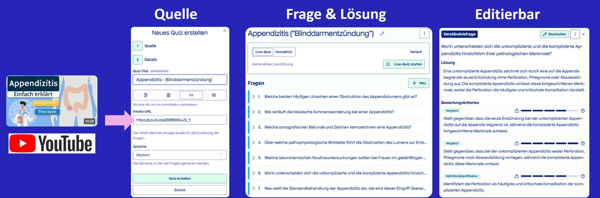

# Dr. Jürgen Kupper

Medizindidaktik & Digital Health · MSH Medical School Hamburg · Hamburg

Ich baue KI-Werkzeuge für meine Lehre selbst – mit Coding-Assistenten, LLM-APIs (Claude, Gemini) und lokalen Modellen; Python/Flask.
Gemeinsames Muster: **Das Modell schlägt vor, der Mensch entscheidet – und jede KI-Ausgabe bleibt prüfbar.**

Davor: Produkt- und Partnerschaftsverantwortung in Life Sciences und Diagnostik – PerkinElmer (Leader Live Cell Imaging), Evotec, 2cureX, Diagnostikzentrum am UKE.

*I build my own AI tools for medical teaching. Common pattern: the model proposes, a human decides – and every AI output stays verifiable.*

| Werkzeug | Was es löst | Technik |
|---|---|---|
| [KvizMe](#kvizme--aus-quellen-werden-prüfbare-verständnisfragen) | Verständnis statt Wiedererkennen prüfen | LLM-APIs, Python/Flask |
| [Lecture Optimizer](#lecture-optimizer--folien-gegen-aktuelle-quellen-prüfen) | Veraltete Folieninhalte finden | LLM-API, Python/Flask |
| [Lecture Annotator](#lecture-annotator--sprechernotizen-verbessern) | Rohe Transkripte → brauchbare Notizen | LLM-API, Python/Flask |
| [Voice Synthesizer](#voice-synthesizer--vertonte-vorlesungen-ohne-studio) | Vertonte Vorlesungen ohne Studio | F5-TTS lokal, Gemini |
| [Edu-Figure-Generator](#edu-figure-generator--lehrabbildungen-aus-vorlesungsnotizen) | Fachlich korrekte Lehrabbildungen | Gemini-Bildmodell |

---

## KvizMe – aus Quellen werden prüfbare Verständnisfragen
**Problem:** Multiple Choice prüft Wiedererkennen, nicht Verständnis; mündliche Prüfungen skalieren nicht.
**Lösung:** Aus einer Quelle – Lernvideo, Text oder Fachdokument – entstehen *KvizUnits*: Verständnisfragen mit Musterlösung und Bewertungskriterien. Lernende antworten frei; ein LLM bewertet die Antwort gegen die einzelnen Kriterien und gibt Feedback je Kriterium.
**Bewusste Entscheidung:** Kriterien statt Gesamturteil – jede Bewertung ist nachvollziehbar. Die Quelle ist die einzige Grundlage; ein Prüfschritt sichert die Quelltreue. Fragen, Lösungen und Kriterien bleiben vollständig editierbar.

**1 · Erstellen:** Quelle eingeben → Fragen & Musterlösungen → editierbare Bewertungskriterien

**2 · Bewerten:** freie Antwort → Feedback je Kriterium

Ob das wirkt, untersuche ich in einer Crossover-Studie an der MSH: KvizMe gegen Multiple Choice bei identischem Lernstoff.

## Lecture Optimizer – Folien gegen aktuelle Quellen prüfen
**Problem:** Digital-Health-Inhalte veralten schnell, etwa die DiGA-Rechtslage.
**Lösung:** Ein LLM erstellt je Folie einen Befund mit Schweregrad, Begründung und datierten Belegen.
**Bewusste Entscheidung:** Das Modell sagt ausdrücklich, was es nicht geprüft hat; übernommen wird erst nach Bestätigung.

## Lecture Annotator – Sprechernotizen verbessern
**Problem:** Eingesprochene Vorlesungen ergeben rohe Transkripte statt brauchbarer Sprechernotizen.
**Lösung:** Notizen werden mit Folienbild und Vorlesungskontext überarbeitet.
**Bewusste Entscheidung:** Original, Transkript und editierte Fassung bleiben erhalten, mit Undo und Markierung niedriger Konfidenz – jeder KI-Eingriff ist umkehrbar.

## Voice Synthesizer – vertonte Vorlesungen ohne Studio
**Problem:** Digitale Lehre braucht Audio, ein Studio fehlt.
**Lösung:** Ein lokales Sprachmodell (F5-TTS) spricht die Notizen mit meiner Stimme ein und bettet das Audio in die Folien ein.
**Bewusste Entscheidung:** Fachbegriffe korrigiert ein einfaches Aussprache-Wörterbuch statt Nachtraining.

## Edu-Figure-Generator – Lehrabbildungen aus Vorlesungsnotizen
**Problem:** Gute Lehrabbildungen sind teuer, generische KI-Bilder fachlich oft ungenau.
**Lösung:** Aus einer Notiz wird ein Bildauftrag mit wählbarem Stil; Entwürfe werden per Feedback verfeinert.
**Bewusste Entscheidung:** Bildmodelle verfälschen Text. Fehler werden direkt im Entwurf markiert und gezielt nachgebessert, statt neu zu generieren.

---

Die Werkzeuge laufen lokal;
[LinkedIn](https://www.linkedin.com/in/juergenkupper/)

